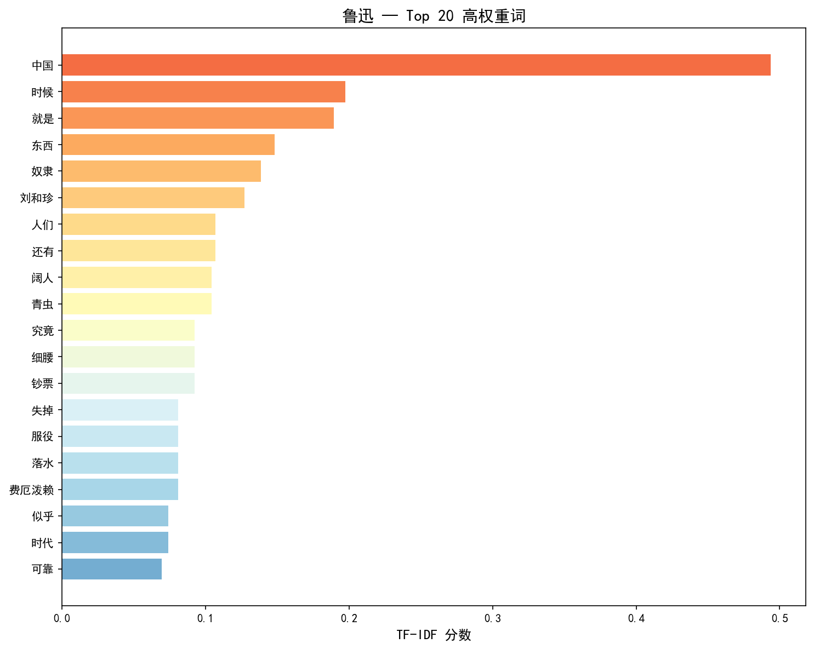
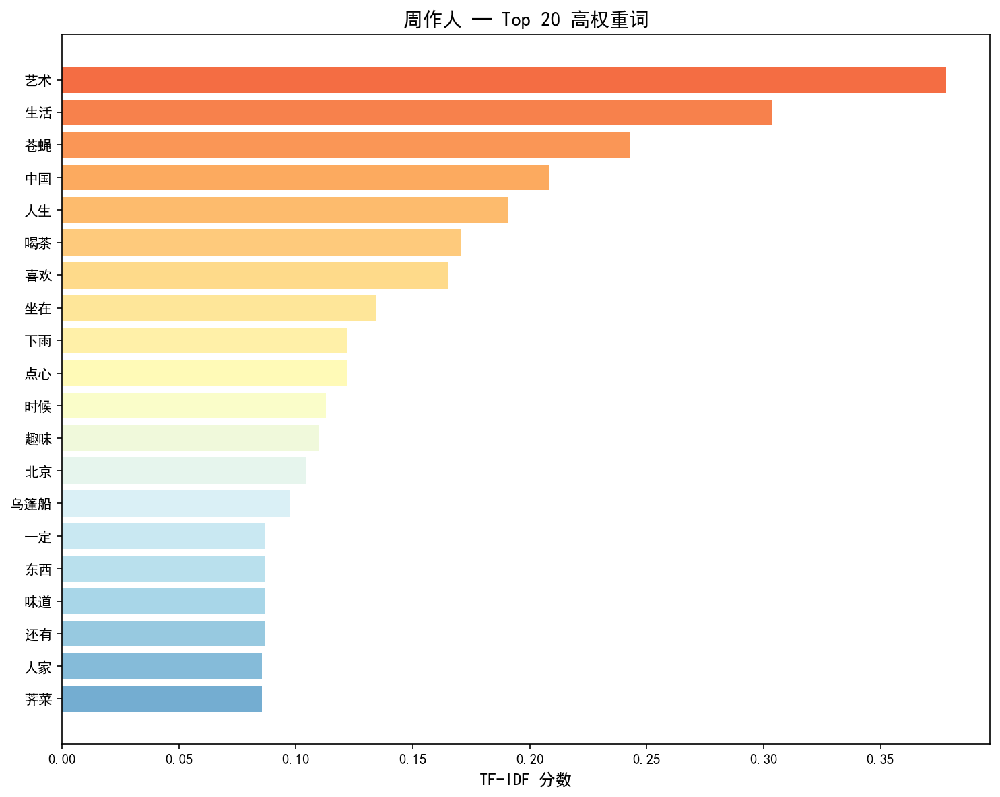
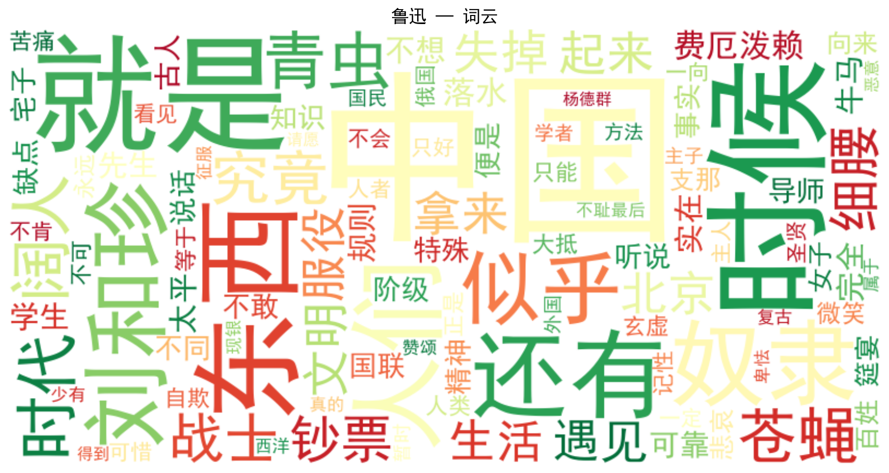
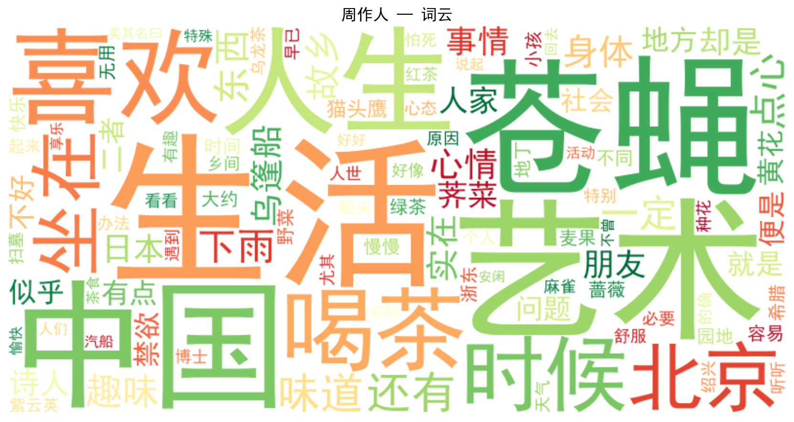

# 鲁迅 vs 周作人 — 基于 TF-IDF 的散文关键词对比分析

> 实验日期：2026-11-12 · 鲁迅语料 10 篇杂文 · 周作人语料 10 篇随笔

---

## 一、主题 / 关键词表

### 鲁迅 Top 15 高权重词

| 排名 | 词 | TF-IDF |
|:---:|:---|:---:|
| 1 | 中国 | 0.494 |
| 2 | 时候 | 0.197 |
| 3 | 就是 | 0.189 |
| 4 | 东西 | 0.148 |
| 5 | 奴隶 | 0.139 |
| 6 | 刘和珍 | 0.127 |
| 7 | 人们 | 0.107 |
| 8 | 还有 | 0.107 |
| 9 | 阔人 | 0.104 |
| 10 | 青虫 | 0.104 |
| 11 | 究竟 | 0.092 |
| 12 | 细腰 | 0.092 |
| 13 | 钞票 | 0.092 |
| 14 | 失掉 | 0.081 |
| 15 | 服役 | 0.081 |

### 周作人 Top 15 高权重词

| 排名 | 词 | TF-IDF |
|:---:|:---|:---:|
| 1 | 艺术 | 0.378 |
| 2 | 生活 | 0.304 |
| 3 | 苍蝇 | 0.243 |
| 4 | 中国 | 0.208 |
| 5 | 人生 | 0.191 |
| 6 | 喝茶 | 0.171 |
| 7 | 喜欢 | 0.165 |
| 8 | 坐在 | 0.134 |
| 9 | 下雨 | 0.122 |
| 10 | 点心 | 0.122 |
| 11 | 时候 | 0.113 |
| 12 | 趣味 | 0.110 |
| 13 | 北京 | 0.104 |
| 14 | 乌篷船 | 0.098 |
| 15 | 一定 | 0.087 |

---

## 二、对照图

### 关键词条形图

**图 1 · 鲁迅 Top 20 高权重词**

**图 2 · 周作人 Top 20 高权重词**

### 词云图

**图 3 · 鲁迅词云（按词频）**

**图 4 · 周作人词云（按词频）**

---

## 三、原文抽查记录

### 抽查 1：🔴 鲁迅 — 高频词「奴隶」

- **出现篇目**：《灯下漫笔》
- **原文语境**：> 中国人向来就没有争到过'人'的价格，至多不过是奴隶，到现在还如此，然而下于奴隶的时候，却是数见不鲜的。
- **核实结论**：该词在《灯下漫笔》中作为核心隐喻贯穿全文，指涉国民性中'想做奴隶而不得'与'暂时做稳了奴隶'的双重困境，是鲁迅批判国民性的关键锚点。

### 抽查 2：🔴 鲁迅 — 高频词「阔人」

- **出现篇目**：《春末闲谈 / 灯下漫笔》
- **原文语境**：> 假使我们的国民都能这样，阔人又何等安全快乐？（《春末闲谈》）
- **核实结论**：'阔人'在两文中均指向统治阶层与既得利益者，与'奴隶''牛马'形成对立，构成鲁迅社会批判的二元结构。

### 抽查 3：🟢 周作人 — 高频词「喝茶」

- **出现篇目**：《喝茶》
- **原文语境**：> 喝茶这件事，我是很喜欢的……喝茶是一种艺术。要喝好茶，好水，好茶具，好点心，好地方，好时间，好心情，好同伴。这八好缺一不可。
- **核实结论**：全文围绕'喝茶'展开，从水质、茶具、冲泡到心境逐一品评，将日常琐事升华为生活艺术，典型体现周作人的闲适格调。

### 抽查 4：🟢 周作人 — 高频词「艺术」

- **出现篇目**：《生活之艺术》
- **原文语境**：> 生活之艺术只在禁欲与纵欲的调和……生活之艺术，其方法只在于微妙地混和取与舍二者而已。
- **核实结论**：该文系统阐发'生活之艺术'理念，以蔼理斯的性心理学和《中庸》为思想资源，追求灵肉调和、动静得中的生活境界，是周作人'美文'主张的理论宣言。

---

## 四、150 字解释

### ✅ 支持的结论

TF-IDF分析清晰呈现了两位作者的文风分野：鲁迅10篇杂文以'奴隶''阔人''失掉''服役'等词构建社会批判话语，指向国民性改造与现实抗争；周作人10篇随笔则以'艺术''生活''喝茶''趣味''乌篷船'等词营造闲适隐逸的审美空间，追求日常生活的艺术化。抽查原文证实这些高频词并非偶然分布，而是各自贯穿全文的核心隐喻与主题锚点。

### ⚠️ 不能证明的

①TF-IDF仅反映词频差异，不能直接推断作者思想的'正确'或'深刻'程度，周作人关注日常生活不等于缺乏社会关怀；②所选10篇样本虽覆盖代表性文集，但未包含鲁迅的小说/散文诗、周作人的抗战下水附逆时期文本，结论仅针对此限定语料；③词向量相似性、情感倾向等维度未纳入，文风对比仍有盲区。

---

*实验报告 · 鲁迅 vs 周作人 TF-IDF 对比 · 2026-11-12*
