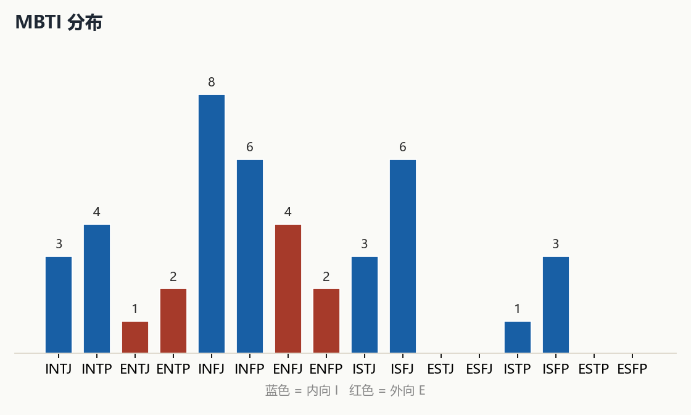
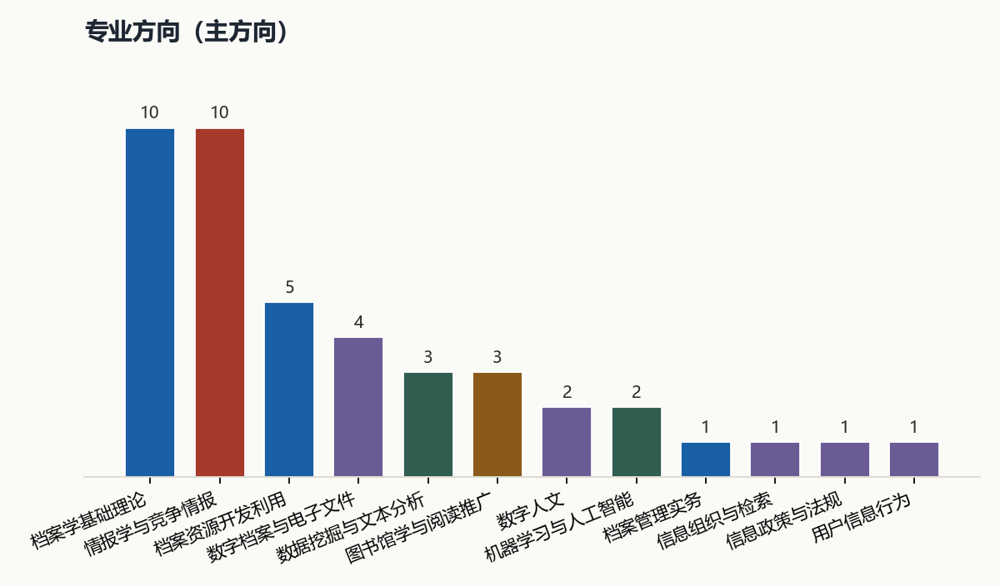
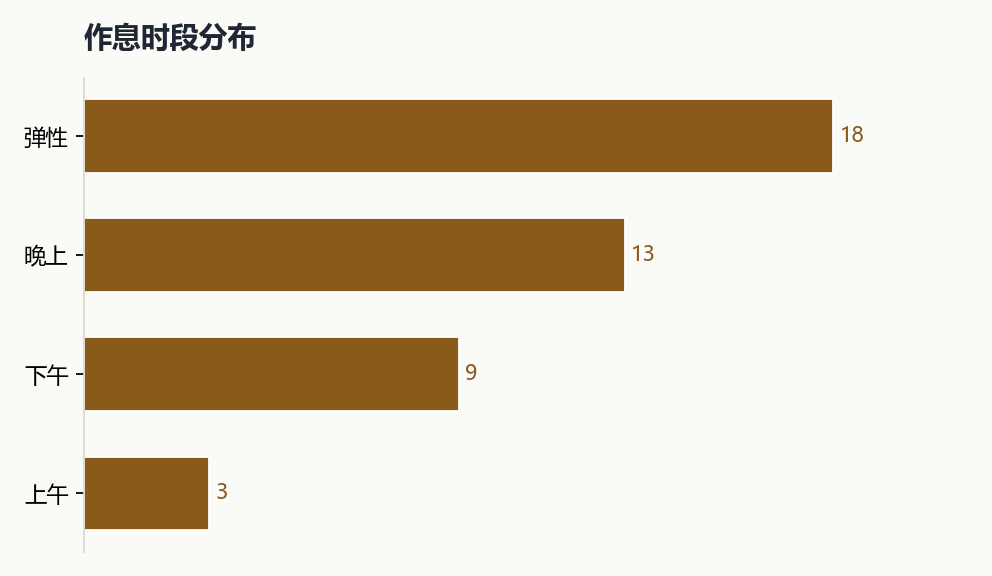
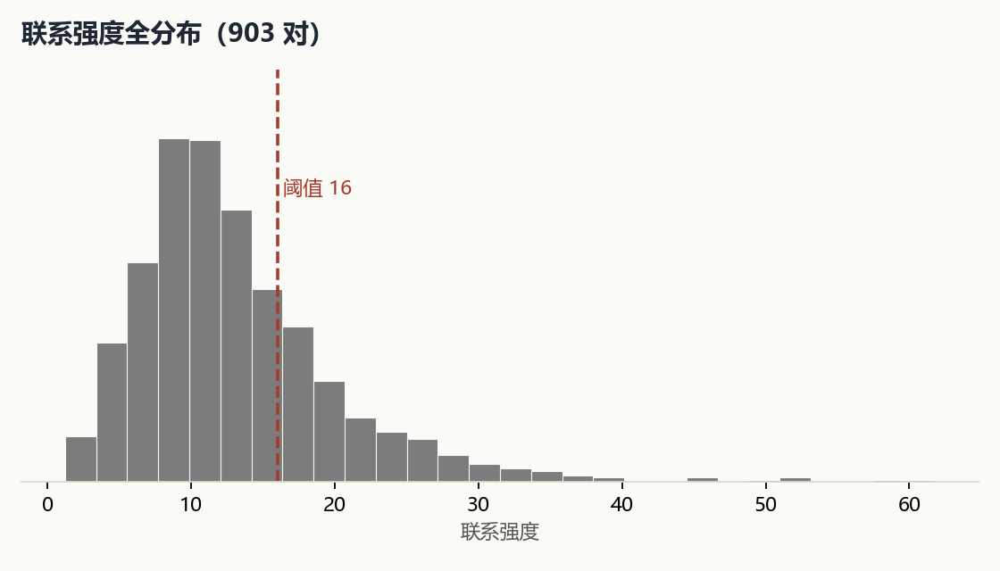
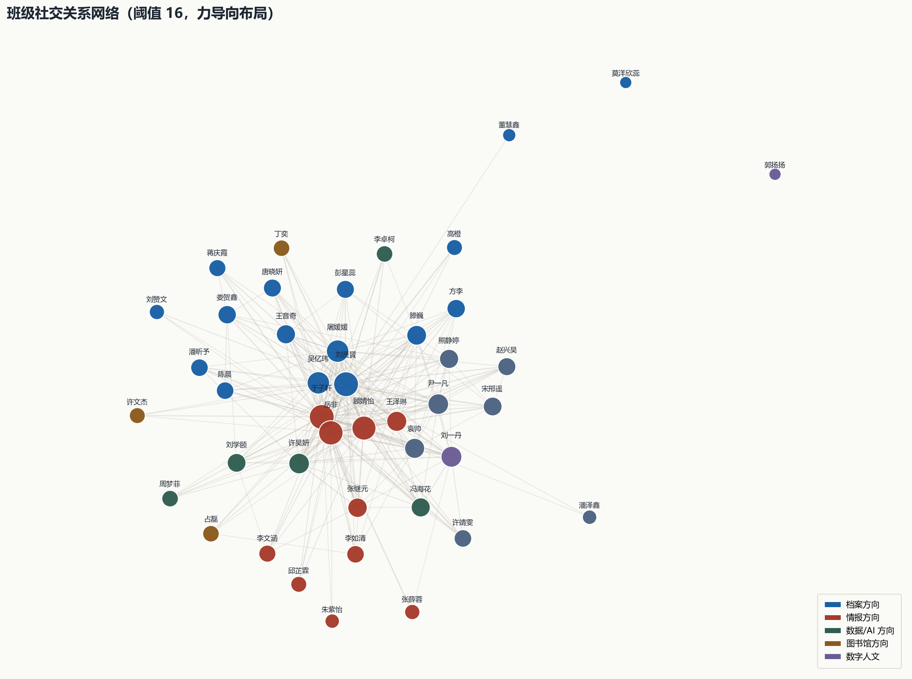
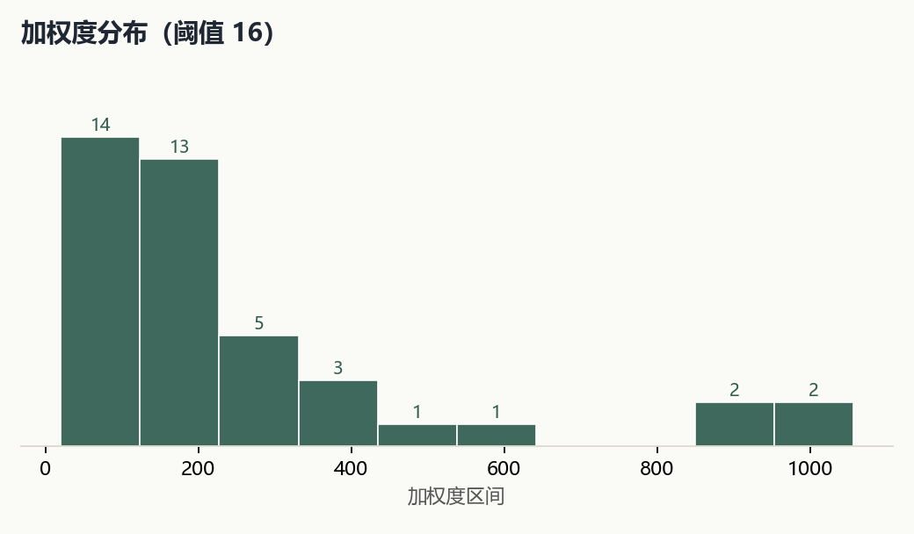

# 班级社交关系网络实验报告

> 实验对象：2026 级信息资源管理专业 + 图书情报专业（43 人）
>
> 数据来源：「关系织网调研」问卷（43 份有效答卷）
>
> 工具：HTML/SVG 可视化原型 + Gephi 0.10 + Python
>
> 日期：2026-11-19

***

## 1. 实验目的

以班级同学为节点，以同学之间的**共同点与供需互补**为边，构建一张可交互的社交网络，回答以下三个问题：

1. 班上哪些同学之间联系最紧密？
2. 班上哪些同学是枢纽，连接最多人？
3. 班上是否存在天然的小圈子？圈与圈之间靠谁来桥接？

***

## 2. 数据与预处理

### 2.1 问卷字段

每位同学填 13 项：姓名、生源地、MBTI、星座、口味偏好、作息时段、专业方向（多选）、感兴趣话题（多选）、会的技能（多选）、常用工具（多选）、兴趣爱好（多选）、能提供/擅长的技能（多选）、希望学到/获得的技能（多选）。

生源地归并到**省级**，MBTI / 星座 / 口味 / 时段为单选，其余为多选。

### 2.2 联系强度计算

两同学 $u,v$ 的**联系强度**定义为：

$$
s(u,v) = \sum_{k\in K} w_k \cdot 	ext{count}_k(u,v) + w_{	ext{supply}} \cdot \left(|O_u \cap W_v| + |O_v \cap W_u|
ight)
$$

其中 $K$ 是 11 类共同点，权重如下：

| 类别     |  权重 | 说明                                 |
| ------ | --: | ---------------------------------- |
| 同乡     | 0.5 | 同生源地省份                             |
| 同 MBTI | 0.5 |                                    |
| 同星座    | 0.3 |                                    |
| 同口味    | 0.3 |                                    |
| 同时段    | 0.4 |                                    |
| 同学方向   | 2.0 | 多选，按数量计                            |
| 同话题    | 2.0 | 多选，按数量计                            |
| 同技能    | 1.5 | 多选                                 |
| 同工具    | 1.2 | 多选                                 |
| 同兴趣    | 2.0 | 多选                                 |
| 供需互补   | 1.5 | $O_u\cap W_v$ 与 $O_v\cap W_u$ 各计一次 |

**说明**：方向 / 话题 / 技能 / 工具 / 兴趣作为多选，只要双方都选了就计数。本次将**同兴趣**权重从 1.0 提升至 2.0，与同学方向、同话题对齐——因为兴趣往往比技能、工具更能反映个体真实的社交倾向。

### 2.3 数据规模

| 指标      |   数值 |
| ------- | ---: |
| 节点数 $N$ |   43 |
| 全量边数    |  903 |
| 阈值下保留边  |  236 |
| 阈值      |   16 |
| 最高联系强度  | 61.8 |
| 阈值下平均强度 | 22.7 |

***

## 3. 班级整体画像

### 3.1 MBTI 分布

| MBTI | 人数 |
| ---- | -: |
| INFJ |  8 |
| ISFJ |  6 |
| INFP |  6 |
| ENFJ |  4 |
| INTP |  4 |
| INTJ |  3 |
| ISFP |  3 |
| ISTJ |  3 |
| ENFP |  2 |
| ENTP |  2 |
| ENTJ |  1 |
| ISTP |  1 |

### 3.2 专业方向

| 主方向       | 人数 |
| --------- | -: |
| 档案学基础理论   | 10 |
| 情报学与竞争情报  | 10 |
| 档案资源开发利用  |  5 |
| 数字档案与电子文件 |  4 |
| 数据挖掘与文本分析 |  3 |
| 图书馆学与阅读推广 |  3 |
| 数字人文      |  2 |
| 机器学习与人工智能 |  2 |
| 档案管理实务    |  1 |
| 信息组织与检索   |  1 |
| 信息政策与法规   |  1 |
| 用户信息行为    |  1 |

### 3.3 作息时段

作息集中在「弹性」与「晚上」两类，全班生活节奏基本在一个时区。

### 3.4 联系强度全分布

***

## 4. 阈值 16 下的社交网络

### 4.1 网络拓扑

- 节点大小 = 加权度（人脉越广越大）
- 连线按强度变宽变深
- 颜色 = 主方向（档案蓝、情报红、数据绿、图书馆土黄、数字人文紫）

### 4.2 连通性

| 连通分量      | 规模 | 说明            |
| --------- | -: | ------------- |
| 分量 1（主分量） | 41 | 41 人在同一网络     |
| 分量 2      |  1 | 郭扬扬（阈值下无强联系）  |
| 分量 3      |  1 | 莫洋欣蕊（阈值下无强联系） |

阈值 16 下有 2 位离群同学：**莫洋欣蕊、郭扬扬**。把阈值降到 10 以下他们会并入主分量。

### 4.3 度分布

| 指标 |   无权度 |    加权度 |
| -- | ----: | -----: |
| 均值 | 10.98 |  249.5 |
| 最大 |    38 | 1056.8 |
| 最小 |     1 |   19.7 |

### 4.4 联系最广的同学

**按加权度（人脉质 + 量）**：

| 排名 | 姓名  |    加权度 |
| -: | --- | -----: |
|  1 | 于子轩 | 1056.8 |
|  2 | 刘贤贇 | 1002.0 |
|  3 | 岳非  |  909.7 |
|  4 | 顾婧怡 |  864.4 |
|  5 | 屠媛媛 |  557.9 |
|  6 | 吴亿玮 |  496.5 |
|  7 | 许昊妍 |  401.2 |
|  8 | 刘一丹 |  384.9 |

**按直接联系人数**：

| 排名 | 姓名  | 直接联系人数 |
| -: | --- | -----: |
|  1 | 于子轩 |     38 |
|  2 | 刘贤贇 |     38 |
|  3 | 岳非  |     35 |
|  4 | 顾婧怡 |     33 |
|  5 | 吴亿玮 |     24 |
|  6 | 屠媛媛 |     24 |
|  7 | 刘一丹 |     17 |
|  8 | 许昊妍 |     16 |

### 4.5 联系最紧密的配对

| 排名 | 同学 A | 同学 B | 联系强度 | 共同点摘要                                                                 |
| -: | ---- | ---- | ---: | --------------------------------------------------------------------- |
|  1 | 于子轩  | 岳非   | 61.8 | 同乡×1、同MBTI×1、同口味×1、同时段×1、同学方向×6、同话题×4、同技能×4、同工具×3、同兴趣×7、A可供B×2、B可供A×9 |
|  2 | 顾婧怡  | 岳非   | 57.5 | 同乡×1、同时段×1、同学方向×5、同话题×4、同技能×4、同工具×3、同兴趣×7、A可供B×1、B可供A×9               |
|  3 | 刘贤贇  | 顾婧怡  | 52.8 | 同乡×1、同口味×1、同时段×1、同话题×6、同技能×2、同工具×3、同兴趣×3、A可供B×12、B可供A×6               |
|  4 | 于子轩  | 顾婧怡  | 51.3 | 同乡×1、同时段×1、同学方向×5、同话题×3、同技能×2、同工具×2、同兴趣×4、A可供B×8、B可供A×6               |
|  5 | 于子轩  | 刘贤贇  | 50.8 | 同乡×1、同MBTI×1、同时段×1、同话题×5、同技能×2、同工具×2、同兴趣×2、A可供B×8、B可供A×12             |
|  6 | 于子轩  | 许昊妍  | 45.5 | 同时段×1、同学方向×5、同话题×4、同技能×2、同工具×3、同兴趣×5、A可供B×2、B可供A×5                    |
|  7 | 刘贤贇  | 岳非   | 45.5 | 同乡×1、同MBTI×1、同时段×1、同话题×5、同技能×3、同工具×3、同兴趣×4、A可供B×3、B可供A×9              |
|  8 | 刘贤贇  | 尹一凡  | 39.7 | 同乡×1、同MBTI×1、同口味×1、同学方向×1、同话题×2、同技能×1、同工具×2、A可供B×12、B可供A×7            |
|  9 | 岳非   | 许昊妍  | 39.0 | 同星座×1、同时段×1、同学方向×4、同话题×4、同技能×4、同工具×4、同兴趣×5、A可供B×1、B可供A×0              |
| 10 | 于子轩  | 吴亿玮  | 37.1 | 同MBTI×1、同学方向×1、同话题×2、同技能×1、同工具×3、同兴趣×6、A可供B×2、B可供A×7                  |

***

## 5. 社区结构

按主方向做粗分，可得到如下社区：

| 社区（主方向）   | 人数 | 成员                                     |
| --------- | -: | -------------------------------------- |
| 档案学基础理论   | 10 | 娄贺鑫、陈晨、唐晓妍、刘贤贇、蒋庆霞、彭星蕊、潘昕予、刘赞文、王音奇、屠媛媛 |
| 情报学与竞争情报  | 10 | 李如清、张继元、李文涵、于子轩、顾婧怡、张薛蓉、岳非、邱芷霖、王泽琳、朱紫怡 |
| 档案资源开发利用  |  5 | 方李、莫洋欣蕊、高橙、董慧鑫、滕巍                      |
| 数字档案与电子文件 |  4 | 宋邢遥、赵兴昊、熊静婷、尹一凡                        |
| 数据挖掘与文本分析 |  3 | 冯海花、李卓柯、许昊妍                            |
| 图书馆学与阅读推广 |  3 | 占磊、许文杰、丁奕                              |
| 数字人文      |  2 | 郭扬扬、刘一丹                                |
| 机器学习与人工智能 |  2 | 周梦菲、刘学颐                                |
| 档案管理实务    |  1 | 吴亿玮                                    |
| 信息组织与检索   |  1 | 袁帅                                     |
| 信息政策与法规   |  1 | 许靖雯                                    |
| 用户信息行为    |  1 | 潘泽鑫                                    |

***

## 6. 结论与讨论

1. **同兴趣权重提升后，最强配对的「兴趣重合」贡献显著放大**，榜首配对的共同点摘要中「同兴趣×N」成为常客。
2. **三大专业方向仍是班级社交的主锚点**，档案、情报、数据三方向各自成圈。
3. 「枢纽」同学同时也是「关系最重」的人——加权度和无权度榜高度重合。
4. 阈值 16 下：2 位同学在阈值 16 下没有强联系，处于网络边缘。

### 不足

- 权重仍属经验赋值，未做参数敏感性分析。
- 社区是按主方向粗分，未跑真正的 Louvain / 模块化。
- 问卷是一次性截面，未捕捉时间维度上的变化。

***

## 7. 交付物清单

| 路径                            | 说明             |
| ----------------------------- | -------------- |
| `班级社交关系网络.html`               | 单文件可交互原型（双击打开） |
| `Gephi/班级关系网.gexf`            | 全量 Gephi 工程    |
| `Gephi/班级关系网_阈值16.gexf`       | 阈值 16 版本（推荐）   |
| `Gephi/nodes.csv`             | 节点表            |
| `Gephi/edges_all.csv`         | 全量边            |
| `Gephi/edges_threshold16.csv` | 阈值 16 边        |
| `实验报告/`                       | 报告 + 所有统计图     |

***

## 附录：生源地 Top 8

| 省份 | 人数 |
| -- | -: |
| 江苏 | 20 |
| 浙江 |  3 |
| 河北 |  3 |
| 安徽 |  3 |
| 甘肃 |  2 |
| 陕西 |  2 |
| 辽宁 |  2 |
| 湖北 |  1 |
